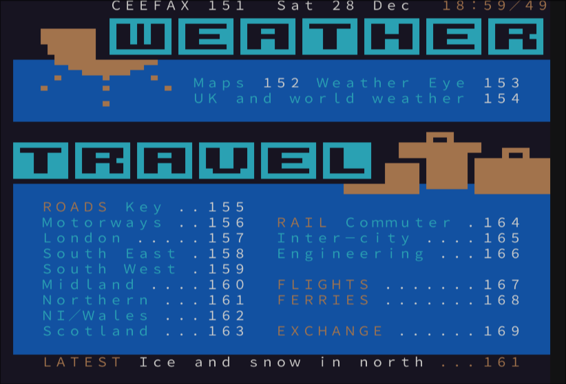

# ttx42

Decode UK Level 1 teletext from raw pages, `.tti` files and `.t42` captures,
then render it in your terminal. Available as a command-line tool and Rust library.



## Usage

```sh
cargo install ttx42

ttx42 page.tti
ttx42 recovery.t42 --page 100 --subpage 1
ttx42 page.bin --reveal --narrow
ttx42 --help
```

Reads stdin when no file is given. Run a `.t42` capture without selectors to
list its pages; page and subpage numbers are hexadecimal.

For Rust projects, add the library with `cargo add ttx42`:

```rust
let page = ttx42::Page::from_raw(&bytes)?;
let grid = ttx42::decode(&page, &ttx42::DecodeOptions::default());
print!("{}", ttx42::to_ansi(&grid, &ttx42::AnsiOptions::default()));
```

## License

WTFPL with an additional clause; see [LICENSE](LICENSE).
Bundled font data is MIT-licensed; see [THIRD_PARTY_LICENSES.md](THIRD_PARTY_LICENSES.md).
